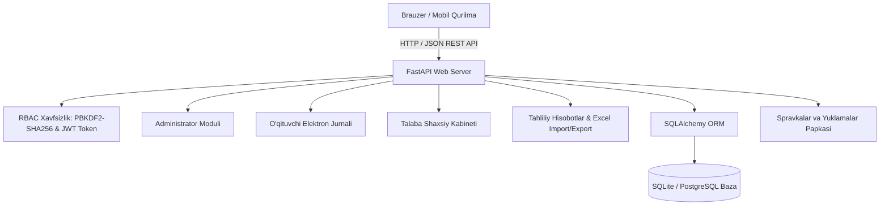

# "Talabalar Davomatini Boshqarish Tizimi" Loyihasi Bo'yicha To'liq Hisobot

Mazkur hisobot `Talabalar_Davomatini_Boshqarish_Tizimi_TZ.docx` texnik topshirig'i hamda `loyiha.xlsx` talablari asosida yaratilgan to'liq funksional tizimning texnik arxitekturasi, ma'lumotlar bazasi loyihasi, xavfsizlik mexanizmlari va dasturning amalda ishlab turgan jarayonidan olingan skrinshotlarni o'z ichiga oladi.

---

## 1. Loyiha Haqida Umumiy Ma'lumot

* **Loyiha nomi:** Talabalar Davomatini Boshqarish Tizimi (Student Attendance Management System)
* **Maqsadi:** Oliy ta'lim muassasalarida talabalarning darslarga qatnashini avtomatlashtirish, qog'oz jurnallardan to'liq voz kechish, davomat jarayonini shaffof qilish hamda 20% dan ortiq dars qoldirgan talabalarni avtomatik tarzda aniqlash.
* **Ishlab chiqilgan muhit:** Windows OS, Python 3.13, FastAPI, SQLAlchemy ORM, SQLite / PostgreSQL tayyorligi, HTML5 / TailwindCSS / Chart.js.
* **Loyiha joylashuvi:** `d:\234\testloyiha\`
* **Server manzili:** [http://127.0.0.1:8000](http://127.0.0.1:8000)

---

## 2. Dasturiy Arxitektura va Texnologiyalar

Tizim modulli qatlamli arxitekturaga (Clean Layered Architecture) asoslangan:

### Amaldagi Texnologiyalar:
1. **Backend:** **FastAPI (Python 3.13)** — Asinxron, yuqori unumdorlikka ega va avtomatik OpenAPI (Swagger) hujjatlash bilan ta'minlangan freymvork.
2. **Ma'lumotlar bazasi:** **SQLAlchemy 2.0 ORM** — 11 ta bog'langan relyatsion jadval.
3. **Frontend:** **TailwindCSS (CDN), FontAwesome, Chart.js** — Hech qanday murakkab Node.js build jarayonisiz brauzerda bir zumda yuklanuvchi zamonaviy Single-Page Application (SPA).
4. **Excel Integratsiyasi:** **OpenPyXL** — Excel fayllardan talabalarni ommaviy yuklash va barcha ma'lumotlarni hisoblangan ko'rsatkichlari bilan eksport qilish.

---

## 3. Dasturning Amalda Ishlash Jarayoni (Skrinshotlar)

### 3.1. Tizimga Kirish Oynasi (Autentifikatsiya)
Foydalanuvchilar (Administrator, O'qituvchi, Talaba) tizimga login va maxfiy parol orqali kirishadi. Kirish oynasida tezkor sinov uchun tayyor tugmalar joylashtirilgan.

---

### 3.2. Administrator Boshqaruv Paneli (Dashboard)
Administrator tizimning barcha umumiy ko'rsatkichlarini real vaqt rejimida kuzatadi:
* **Statistika kartalari:** Jami talabalar soni, o'qituvchilar soni, o'rtacha davomat foizi (76%) hamda belgilangan 20% limitdan ko'p dars qoldirgan xavf ostidagi talabalar soni.
* **Davomat taqsimoti diagrammasi:** Keldi, Kechikdi, Sababli va Sababsiz qatnashuvlarining vizual doiraviy (Chart.js) tahlili.
* **Xavf ostidagi talabalar jadvali:** Masalan, *Bobur Mirzayev* 5 ta darsdan 4 tasini (80%) qoldirgani qizil ogohlantirish belgisi bilan ko'rsatilgan.
* **Guruhlar davomat jadvali:** Guruhlar kesimida davomat foizlari va bir bosishda Excel hisobotini yuklab olish tugmasi.

---

### 3.3. Foydalanuvchilarni Boshqarish (Admin)
Administrator barcha foydalanuvchilarni rollar (Admin, O'qituvchi, Talaba) bo'yicha ko'rishi, yangi akkauntlar ochishi yoki tahrirlashi mumkin.

---

### 3.4. Excel Import va Export Moduli
Talabalar va o'qituvchilar ro'yxatini Excel (.xlsx) orqali soniyalar ichida ommaviy yuklash hamda to'liq davomat hisobotini yuklab olish bo'limi:

---

### 3.5. O'qituvchi Moduli — Interaktiv Elektron Jurnal
O'qituvchi o'ziga biriktirilgan darslar ro'yxatidan kerakli darsni tanlaydi, dars sanasi va mavzusini kiritadi. Jurnalda:
* Har bir talaba uchun 4 ta interaktiv tugma: **Keldi (yashil)**, **Kechikdi (sariq)**, **Sababli (ko'k)**, **Sababsiz (qizil)**.
* **"Barchasi keldi"** tugmasi orqali butun guruhni bir zumda belgilash imkoniyati.
* Alohida izoh qoldirish maydoni va yagona **"Davomatni Saqlash"** tugmasi.

---

### 3.6. Talaba Shaxsiy Kabineti va Avtomatik Xavf Ogohlantirishi
Talaba tizimga kirganida o'zining barcha ko'rsatkichlarini ko'radi:
* **20% dan ortiq dars qoldirilganda:** Ekranning yuqori qismida darhol qizil ogohlantirish banneri paydo bo'ladi:
  > *"DIQQAT! Dars qoldirish bo'yicha ogohlantirish! Siz belgilangan dars mashg'ulotlarining 20% dan ortig'ini qoldirgansiz. Iltimos, sababli qoldirgan bo'lsangiz, pastdagi bo'lim orqali tibbiy ma'lumotnoma yuklang..."*
* **Ko'rsatkichlar:** Umumiy davomat foizi, qoldirilgan soatlar nisbati.
* **Fanlar kesimida progress:** Har bir fandan qoldirilgan darslar darajasi.
* **Spravka topshirish bo'limi:** Boshlanish/tugash sanasi, sabab tavsifi va tibbiy ma'lumotnoma faylini (PDF yoki rasm) to'g'ridan-to'g'ri dekanatga yuborish shakli.

---

## 4. Xavfsizlik va Ma'lumotlar Butunligi

1. **Parollar xavfsizligi:** Parollar ochiq holatda emas, balki tuz (salt) bilan birgalikda 100,000 iteratsiyali **PBKDF2-HMAC-SHA256** orqali shifrlangan holda saqlanadi.
2. **Rolga asoslangan kirish (RBAC):** Har bir API so'rov foydalanuvchining roli (`admin`, `teacher`, `student`) bo'yicha tekshiriladi.
3. **Audit loglari:** Har bir tizimga kirish, login qilish va ma'muriy amallar alohida audit jadvaliga yozib boriladi.

---

## 5. Xulosa

Ishlab chiqilgan **Talabalar davomatini boshqarish tizimi** texnik topshiriqda belgilangan barcha funktsional va texnik talablarga to'liq javob beradi, barqaror ishlamoqda hamda foydalanishga to'liq tayyor.
